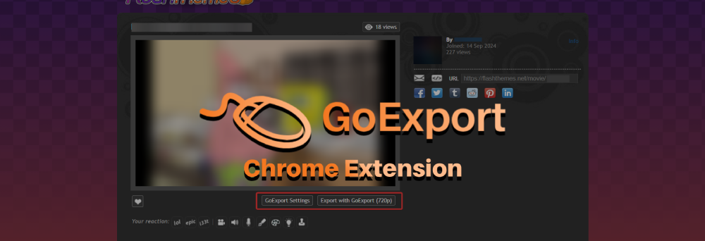

# GoExport Chrome Extension

A Chrome extension that adds a direct link to GoExport on FlashThemes pages.

## Features

- Adds a "Export with GoExport" link on FlashThemes movie pages for easy exporting.
- Customizable settings to configure GoExport

## Installation

1. Visit the Releases tab and download the latest version of the extension. (Download the CRX file)
2. Open Chrome and navigate to `chrome://extensions/`.
3. Enable "Developer mode" using the toggle in the top right corner.
4. Drag and drop the downloaded CRX file onto the extensions page to install it.
5. Configure the extension settings by clicking on "Details" under the GoExport Extension and then "Extension options".

## Versions

| Extension | Branch | Works with |
| --------- | ------ | ---------- |
| 2.x       | `2.x`  | GoExport v2 (`goexport://record?...` links) |
| 1.x       | `1.x`  | GoExport v1 |

## Key Details

- GoExport v2 must be installed and its URL protocol registered with `GoExport install protocol` (see the [URL protocol wiki page](https://github.com/GoExport/GoExport/wiki/URL%E2%80%90Protocol)).
- The export button sends the movie ID, the owner's user ID, your resolution, format, widescreen and outro choices, and every server setting from GoExport's FlashThemes preset (`url`, `api_url`, `swf_url`, `store_path`, `client_theme_path`). GoExport shows these and asks you to confirm before recording.
- In order to modify GoExport settings from the extension options page, right click on the GoExport (mouse) icon in the Chrome toolbar and select "Options".

## Support

For support, please open an issue on the [GitHub repository](https://github.com/GoExport/GoExport/issues).

## License

This project is licensed under the GNU General Public License v3.0 - see the [LICENSE](LICENSE) file for details.

**Legal Disclaimer:** This software is provided "as is" without warranty of any kind. The authors and contributors are not liable for any damages arising from the use of this software. Users are responsible for complying with all applicable laws and terms of service when using this extension.
